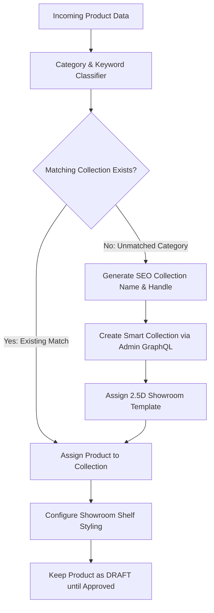

# Product-Driven Collection Automation System

> **Store**: `ikwh1h-fx.myshopify.com` (`Trymalora Official Store`)  
> **Target Environment**: Shopify Admin API & Automation Scripts  
> **Status**: Ready for Deployment  

---

## 1. System Overview

To maintain a clean, organized, SEO-friendly store catalog without manual human errors or duplicate categories, the **Product-Driven Collection Automation Engine** governs how incoming products are categorized and published to the 2.5D Showroom.

---

## 2. Category Taxonomy & Shelf Style Rules

| Product Keywords / Signal | Auto-Assigned Collection | Handle | Showroom Shelf Style | Spotlights |
| :--- | :--- | :--- | :--- | :--- |
| `toy`, `laser`, `blaster`, `rc`, `game`, `drone` | **Interactive Toys** | `interactive-toys` | `tech` (Dark Obsidian) | Vibrant Electric Blue / Cyan |
| `storage`, `organizer`, `pillow`, `clock`, `decor` | **Smart Home & Living** | `smart-home-living` | `wood` (Natural Oak) | Warm 3200K Halogen |
| `wellness`, `massage`, `therapy`, `hair`, `recovery`| **Health & Wellness** | `wellness-recovery` | `boutique` (Lacquered White)| Soft Daylight Amber |
| `tool`, `cutter`, `light`, `drywall`, `workshop` | **Tools & Hardware** | `tools-hardware` | `metal` (Brushed Steel) | Cool 5000K Industrial |

---

## 3. Automation Implementation Script

The engine operates via [`scripts/auto_collection_assign.mjs`](file:///c:/Users/Admin/Desktop/TRYMALORA/scripts/auto_collection_assign.mjs) which leverages Shopify's GraphQL Admin API (`collectionCreate`, `collectionAddProducts`).

### Anti-Duplication Safeguard:
1. Standardizes collection titles and slugifies handles (e.g. `Interactive Toys` &rarr; `interactive-toys`).
2. Checks existing store collection handles before executing creation.
3. Automatically maps near-synonyms (e.g., `Kids Toys`, `Laser Guns`, `Play Sets` all resolve to `Interactive Toys`).
4. Ensures the `collection.showroom.json` template suffix is assigned automatically.
