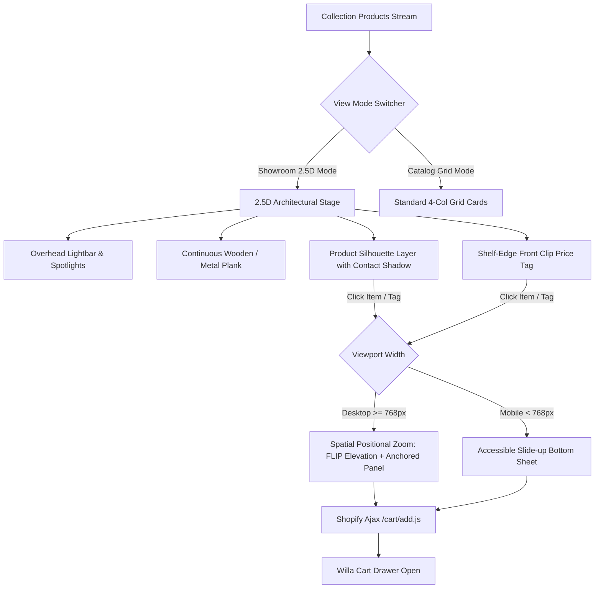

# 2.5D Physical Retail Showroom: Technical System Audit

> **Auditor**: Senior Systems & Frontend Solution Architect  
> **Target Store**: `ikwh1h-fx.myshopify.com` (`Trymalora Official Store`)  
> **Source Files**: 
> - Liquid Architecture: [`sections/zavelyn-v4-showroom.liquid`](file:///c:/Users/Admin/Desktop/TRYMALORA/sections/zavelyn-v4-showroom.liquid)  
> - Stylesheet & Physics: [`assets/zavelyn-v4-showroom.css`](file:///c:/Users/Admin/Desktop/TRYMALORA/assets/zavelyn-v4-showroom.css)  
> - Spatial Interaction Controller: [`assets/zavelyn-v4-showroom.js`](file:///c:/Users/Admin/Desktop/TRYMALORA/assets/zavelyn-v4-showroom.js)  
> - Routing Templates: [`templates/collection.showroom.json`](file:///c:/Users/Admin/Desktop/TRYMALORA/templates/collection.showroom.json), [`templates/index.json`](file:///c:/Users/Admin/Desktop/TRYMALORA/templates/index.json)  
> **Status**: Production Read-Only / Verified

---

## 1. Executive Summary & Core Concept

The **Zavelyn V4 Physical Retail Showroom** is an advanced 2.5D merchandising interface engineered to recreate the sensory experience of a brick-and-mortar boutique. Traditional eCommerce catalog pages present products as disconnected 2D rectangular cards; the Zavelyn Showroom places products on **architectural shelving fixtures** equipped with:
- Directional overhead ceiling spotlights.
- Continuous multi-layer oak and steel planks with simulated perspective and grain.
- Grounded elliptical contact and ambient shadow discs.
- **Shelf-Edge Channel Price Tags** that hook onto the front shelf moulding, keeping product bases clean.
- A **Spatial Positional Zoom Bay (FLIP animation)** on desktop that pulls the physical product forward from its exact shelf coordinate for inspection, alongside a viewport-clamped buy panel.



---

## 2. Architectural Theme Variants

The showroom dynamically adapts its materials based on section settings or collection taxonomy:

| Theme Slug | Material & Aesthetic | Visual Treatment & CSS Palette | Automatic Handle Trigger |
| :--- | :--- | :--- | :--- |
| **`wood`** *(Default)* | Natural White Oak & Brass | Top surface: `#B57F44` to `#E4B880` gradient; Fascia: `#9C652E` to `#5D3712`; Beveled highlight: `#EEC58E`. | General lifestyle, home goods, kitchen essentials. |
| **`metal`** | Industrial Workshop Steel | Top surface: `#37474F` to `#607D8B`; Fascia: `#263238` brushed steel; Lighting: Cool 5000K white spotlights. | Handles containing `tool` or `power`. |
| **`tech`** | Dark Obsidian Studio | Top surface: `#0F172A` midnight slate; Fascia: `#1E293B` matte carbon; Lighting: Subtle electric blue refraction. | Handles containing `handpan`, `drum`, or `sound`. |
| **`boutique`** | Clean Lacquered White | Top surface: `#FFFFFF` pearl satin; Fascia: `#F3F4F6` with brass clip brackets; Warm ambient occlusion. | Handles containing `wellness`, `denture`, `batana`. |
| **`floating`** | Minimalist Glass Display | Translucent acrylic shelf with backdrop blur (`backdrop-filter: blur(8px)`). | Configurable via Theme Editor select. |

### Liquid Automatic Theme Resolution
Declared at lines 15–22 of [`sections/zavelyn-v4-showroom.liquid`](file:///c:/Users/Admin/Desktop/TRYMALORA/sections/zavelyn-v4-showroom.liquid#L15-L22):
```liquid


  

  

  

```

---

## 3. 2.5D Physical Shelf Geometry & Physics Stack

Each tier in the physical showroom is assembled as a **6-layer spatial stack**:

```
Layer 6 [z-index: 6]: Shelf-Edge Channel Price Tag (.zv-shelf-clip-tag)
Layer 5 [z-index: 5]: Product Grid & Silhouette Container (.zv-cutout-container)
Layer 4 [z-index: 3]: Ceiling Spotlights & Directional Beams (.zv-spotlight-beam)
Layer 3 [z-index: 2]: Continuous Top Surface Plank (.zv-wood-top-surface, rotateX: 28deg)
Layer 2 [z-index: 2]: Front Vertical Fascia Moulding (.zv-wood-front-fascia)
Layer 1 [z-index: 1]: Ground Contact & Ambient Shadow Discs (.zv-shelf-contact-shadow)
Layer 0 [z-index: 0]: Under-Shelf Wall Drop Shadow (.zv-wood-under-shadow)
```

### 3.1 Layer Details in [`assets/zavelyn-v4-showroom.css`](file:///c:/Users/Admin/Desktop/TRYMALORA/assets/zavelyn-v4-showroom.css)
1. **Directional Lighting Beam (`.zv-spotlight-beam`)**:
   - Anchored to `.zv-fixture-lightbar`.
   - Casts a soft radial spotlight beam (`radial-gradient(ellipse at 50% 0%, rgba(255,255,255,0.35) 0%, transparent 70%)`) above each column position (`12.5%`, `37.5%`, `62.5%`, `87.5%`).
2. **Solid Wooden Plank Top Surface (`.zv-wood-top-surface`)**:
   - 28px height transformed via 3D perspective: `transform: perspective(700px) rotateX(28deg); transform-origin: bottom center;`.
   - Linear wood grain repeating pattern (`repeating-linear-gradient(90deg, ...)`).
   - Inset top highlight (`inset 0 2px 4px rgba(255,255,255,0.5)`).
3. **Front Vertical Fascia (`.zv-wood-front-fascia`)**:
   - 34px vertical thickness providing physical weight.
   - 2px top beveled edge highlight (`#EEC58E`) catching the ceiling light.
   - Horizontal cross-cut wood grain lines.
4. **Wall Under-Shadow (`.zv-wood-under-shadow`)**:
   - 42px soft gradient with `filter: blur(4px)` casting a realistic drop shadow onto the rear panelled store wall.
5. **Contact Shadow Disc (`.zv-shelf-contact-shadow`)**:
   - Dual-layer radial ellipse positioned at `bottom: 0px`.
   - Parameterized via CSS variables `--shadow-w` (default `70%`), `--shadow-op` (default `0.70`), and `--shadow-h` (default `12px`).
   - Automatically compresses (`scale(0.92)`) when the product is hovered or elevated.

---

## 4. Shelf-Edge Channel Price Tags vs Legacy Card Boxes

A primary flaw of earlier theme prototypes was placing large rectangular white cards directly beneath products on the shelf, creating an artificial "floating card" look. 

The V4 showroom replaces this with **Front Moulding Clip Tags**:
- **Mounting Mechanism**: A molded bracket (`.zv-tag-clip-bracket`, 38px &times; 11px) hooks directly over the front fascia moulding.
- **Card Body (`.zv-tag-card`)**: A compact price tag hanging below the shelf line. Contains product title (with single-line ellipsis), active money price, struck-through comparison price, percentage savings tag, and an interactive prompt (`PULL SHELF ⚡`).
- **Focus & Tactility**: Clicking or tabbing to the tag triggers spatial inspection identically to clicking the product.

```
       [ PRODUCT CUTOUT ]
             /   \
           ( SHADOW )
================================= [ Shelf Top Surface ]
  [ CLIP ]                       [ Shelf Fascia ]
  | CARD |  <-- Hangs below shelf line
  |______/
```

---

## 5. Responsive Shelf Mechanics & Incomplete Row Balance

### 5.1 Desktop Grid (Viewport &ge; 992px / 1024px)
- Maximum **4 products per tier** (`items_per_shelf = 4`).
- Handled via `forloop.index0 | modulo: 4`.
- A continuous wooden shelf plank stretches across all 4 columns.

### 5.2 Dynamic Incomplete Row Balancing
When a collection contains an irregular number of items (e.g. 5, 7, 9 items), traditional CSS grids leave orphaned items floating awkwardly on the far left. The Zavelyn showroom calculates remaining items per row dynamically in Liquid and applies tailored grid layouts:

| Remaining Products | Applied Grid Class | Architectural Layout Behavior |
| :---: | :--- | :--- |
| **4** | `.zv-grid--4` | Full width, `grid-template-columns: repeat(4, 1fr)`, 32px gap. |
| **3** | `.zv-grid--3` | Centered shelf stage, `grid-template-columns: repeat(3, 1fr)`, `max-width: 980px; margin: 0 auto;`. |
| **2** | `.zv-grid--2` | Centered shelf stage, `grid-template-columns: repeat(2, 1fr)`, `max-width: 720px; margin: 0 auto;`. |
| **1** | `.zv-grid--1` | **Hero Pedestal Center**: `grid-template-columns: 1fr`, `max-width: 380px; margin: 0 auto;` (centered on shelf). |

### 5.3 Mobile Architecture (Viewport < 992px)
- Modularized into **Pairs of 2** (`zv-shelf-pair`, `zv-pair-products`).
- The desktop continuous plank is hidden via `.zv-shelf-desktop-only { display: none !important; }`.
- A dedicated mobile plank (`.zv-shelf-mobile-only`) renders per pair at `top: 174px`.
- Odd items cleanly occupy a single-pair centered layout without overflow.

---

## 6. Interaction Lifecycle: Positional Zoom (FLIP) vs Mobile Sheet

The interaction engine in [`assets/zavelyn-v4-showroom.js`](file:///c:/Users/Admin/Desktop/TRYMALORA/assets/zavelyn-v4-showroom.js) handles inspection across desktop and mobile.

### 6.1 Desktop Spatial Positional Zoom (FLIP Animation)
Replaces generic modal dialogs with a physical pull-forward animation:
1. **Coordinate Capture (First)**: Measures `activeShelfItem.getBoundingClientRect()`.
2. **Shelf Dimming**: Adds `.zv-shelf-dimmed` to all sibling shelf items, blurring and fading them to `0.32` opacity while leaving the store environment visible.
3. **Focal Frame Initialization**: Sets the zoom frame (`#zvInspectFocalFrame`) to `position: fixed` precisely over the product's origin coordinates (`left`, `top`, `width`, `height`).
4. **Horizontal Raycasting & Clamping (Last & Invert)**:
   - If product center is on the **left half** of viewport (`< 50%`):
     - Anchored card (`#zvInspectAnchoredPanel`) is placed to the **right** of the product.
     - Product is shifted slightly left: `deltaX = clamp(...)`.
   - If product center is on the **right half** of viewport (`>= 50%`):
     - Anchored card is placed to the **left** of the product.
     - Product is shifted slightly right.
   - Card vertical position is clamped: `Math.max(24, Math.min(rect.top - 20, window.innerHeight - 460 - 24))` to **prevent viewport blowout**.
5. **Play (FLIP Transition)**:
   - On the next animation frame, transitions `transform: translate(deltaX, -24px) scale(1.45)` with `cubic-bezier(0.16, 1, 0.3, 1)`.
   - Card slides into position with `opacity: 1; transform: translateX(0) scale(1)`.

### 6.2 Adaptive Variant Selector (Sub-4 vs Multi-Option)
To prevent variant selection lists from expanding vertically and breaking the card:
- **&le; 4 Options**: Renders compact rounded pill buttons.
- **> 4 Options**: Renders a sleek styled native `<select class="zv-variant-dropdown">` showing option titles and prices, maintaining strict card height.

### 6.3 Mobile Bottom Sheet (< 768px Viewports)
On mobile devices, tapping any shelf item triggers `openMobileSheet()`, sliding up `#zvMobileSheetOverlay` from the bottom with a tactile drag handle, high-res image preview, adaptive variant selector, and direct `ADD TO CART` button.

---

## 7. Theme Editor Customization Blocks (`product_image_override`)

Merchandisers can fine-tune product visual presentation per item in the Shopify Theme Editor without modifying source code:

| Setting ID | Type | Default | Operational Impact |
| :--- | :--- | :--- | :--- |
| `product` | `product` | blank | Target product selector. |
| `enable_override` | `checkbox` | `true` | Toggles override rules on/off. |
| `showroom_image` | `image_picker`| blank | Dedicated transparent PNG cutout for shelf display. |
| `catalog_image` | `image_picker` | blank | Secondary image for catalog grid mode. |
| `use_same_image` | `checkbox` | `false` | Mirrors showroom image to catalog grid. |
| `display_scale` | `range (60-150%)`| `100%` | Desktop silhouette scaling factor. |
| `mobile_scale` | `range (60-150%)`| `100%` | Mobile silhouette scaling factor. |
| `baseline_offset` | `range (-50 to 50px)`| `0px` | Vertical shelf grounding adjustment. |
| `horizontal_offset`| `range (-50 to 50px)`| `0px` | Horizontal optical centering adjustment. |
| `enable_contact_shadow`| `checkbox`| `true` | Toggles grounded contact shadow disc. |
| `shadow_width` | `range (30-100%)`| `70%` | Width of the contact shadow ellipse. |
| `shadow_opacity` | `range (10-100%)`| `70%` | Darkness intensity of the shadow disc. |
| `reset_original` | `checkbox` | `false` | One-click restore to raw product featured image. |

---

## 8. View Mode Switcher & Catalog Grid Fallback

In the showroom toolbar:
```html
<div class="zv-view-switcher" role="group" aria-label="Display View Mode">
  <button type="button" class="zv-view-btn active" data-view-mode="shelf">Showroom</button>
  <button type="button" class="zv-view-btn" data-view-mode="grid">Grid</button>
</div>
```
- Mode is persisted via `localStorage.setItem('zv_showroom_view', mode)` and URL query parameter (`?view=grid` or `?view=showroom`).
- Switching to `grid` toggles `.grid-mode` on `#zvShowroomStage`:
  - Shelf wooden planks, fixture lightbars, and shadow discs are hidden.
  - Standard responsive 4-column catalog cards (`.zv-cat-card`) render with star ratings, sale badges, and direct add-to-cart buttons (`zvShowroomDirectAddToCart`).

---

## 9. Solution Architect Summary & Recommendations

1. **Performance**: Zero external physics libraries (e.g. Three.js or Cannon.js) are used. Everything runs on GPU-accelerated CSS 3D transforms (`rotateX`, `scale`, `translate3d`), guaranteeing 60fps scrolling on low-power mobile devices.
2. **Merchandising Scalability**: Merchandisers should be encouraged to upload pre-clipped transparent PNGs into `showroom_image` blocks or use the `custom.showroom_cutout` product metafield for instant retail-grade realism.
3. **Next Phase Recommendation**: Expand the theme editor blocks to allow custom material wood textures (e.g., Walnut, Maple, Marble) by parameterizing `.zv-wood-top-surface` background images in `settings_schema.json`.
