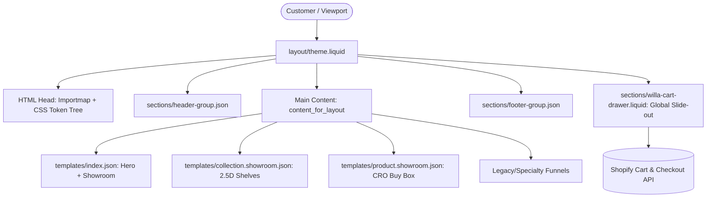
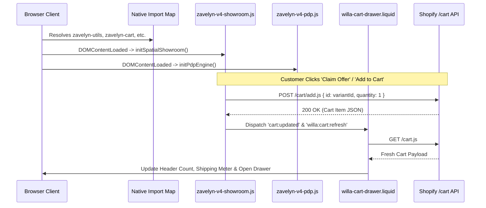

# Architecture Technical Audit: Trymalora Shopify OS 2.0 Theme

> **Auditor**: Senior Systems & Frontend Solution Architect  
> **Target Store**: `ikwh1h-fx.myshopify.com` (`Trymalora Official Store`)  
> **Active Environment**: Shopify CLI 3.x/4.x Local Development Server  
> **Production Code Status**: **Read-Only / Unmodified**  
> **Audit Date**: November 2026

---

## 1. Executive Summary & Repository Overview

The **Trymalora** storefront is a customized, high-performance hybrid Shopify Online Store 2.0 (OS 2.0) theme. Built upon a minimalist Dawn architectural core, it has been heavily re-architected with:
1. **Zavelyn V4 2.5D Physical Showroom System**: An architectural retail environment replacing traditional catalog card grids with simulated shelving, realistic lighting, contact shadow discs, edge-clip price rails, and spatial inspection bays.
2. **CRO High-Conversion PDP Engine**: Inspired by top-tier direct-to-consumer benchmarks (such as [shopsidek.com/templates/t01/](https://shopsidek.com/templates/t01/)), featuring multi-tiered Kaching-style bundle selectors, dynamic free gift unlock progress bars, adaptive variant controllers, and sticky one-click checkout triggers.
3. **Global Slide-Out Cart Ecosystem**: Powered by [willa-cart-drawer.liquid](file:///c:/Users/Admin/Desktop/TRYMALORA/sections/willa-cart-drawer.liquid) and native Ajax cart endpoints (`/cart/add.js`, `/cart/change.js`, `/cart.js`), synchronizing instantly across showroom cards, PDP bundles, and header icons without page reloads.
4. **Direct-Response Landing & Funnel Clusters**: Over 20 specialized standalone funnel templates and sections (e.g., balm, heat lamp, sinusitis, ultrasonic cutters) embedded directly within the theme repository.



---

## 2. Complete Directory Hierarchy & File Inventory

The repository strictly follows Shopify CLI Online Store 2.0 theme conventions:

| Directory | Items | Primary Purpose & Contents |
| :--- | :--- | :--- |
| [`layout/`](file:///c:/Users/Admin/Desktop/TRYMALORA/layout) | 3 files | Base layout wrappers: [`theme.liquid`](file:///c:/Users/Admin/Desktop/TRYMALORA/layout/theme.liquid) (master layout), [`theme.password.liquid`](file:///c:/Users/Admin/Desktop/TRYMALORA/layout/theme.password.liquid), [`theme.landing.liquid`](file:///c:/Users/Admin/Desktop/TRYMALORA/layout/theme.landing.liquid). |
| [`sections/`](file:///c:/Users/Admin/Desktop/TRYMALORA/sections) | 107 files | Modular Liquid components. Houses core V4 showroom, V4 PDP, header/footer groups, and direct-response advertorial funnels. |
| [`templates/`](file:///c:/Users/Admin/Desktop/TRYMALORA/templates) | 48 files | OS 2.0 JSON route definitions (`index.json`, `collection.showroom.json`, `product.showroom.json`) and specialty funnel Liquid templates. |
| [`snippets/`](file:///c:/Users/Admin/Desktop/TRYMALORA/snippets) | 45 files | Reusable micro-partials: `price.liquid`, `product-card.liquid`, `icon-*.liquid`, `pagination.liquid`. |
| [`assets/`](file:///c:/Users/Admin/Desktop/TRYMALORA/assets) | 632 files | CSS tokens, ESM scripts, UI SVGs, product PNG cutouts, optimized WebP graphics, and WOFF2 typography. |
| [`config/`](file:///c:/Users/Admin/Desktop/TRYMALORA/config) | 2 files | Theme settings schema ([`settings_schema.json`](file:///c:/Users/Admin/Desktop/TRYMALORA/config/settings_schema.json)) and merchant configurations ([`settings_data.json`](file:///c:/Users/Admin/Desktop/TRYMALORA/config/settings_data.json)). |
| [`locales/`](file:///c:/Users/Admin/Desktop/TRYMALORA/locales) | 14 files | Internationalization dictionaries (`en.default.json`, `fr.json`, `de.json`, `es.json`, etc.). |
| [`docs/`](file:///c:/Users/Admin/Desktop/TRYMALORA/docs) | 3 files | Solution Architect documentation suite (`STORE_ARCHITECTURE.md`, `SHOWROOM_AUDIT.md`, `PRODUCT_PAGE_REFERENCE.md`). |

---

## 3. Liquid Template & Rendering Lifecycle Architecture

### 3.1 The Master Shell: [`layout/theme.liquid`](file:///c:/Users/Admin/Desktop/TRYMALORA/layout/theme.liquid)

The root document structure is lean, accessible, and standards-compliant:
1. **Dynamic Meta Title Handling**: Sanitizes store branding dynamically, preventing raw handle leaks or legacy placeholders.
2. **Liquid Typography & CSS Variables Injection**: Compiles merchant typography settings into standardized CSS custom properties (`--font-body-family`, `--font-heading-family`, `--space-*`, `--shadow-*`).
3. **Core Style Sheets Cascade**:
   - [`zavelyn-base.css`](file:///c:/Users/Admin/Desktop/TRYMALORA/assets/zavelyn-base.css): CSS resets, accessible focus outlines, box sizing.
   - [`zavelyn-layout.css`](file:///c:/Users/Admin/Desktop/TRYMALORA/assets/zavelyn-layout.css): Flexbox grids, page-width clamps, section spacing.
   - [`zavelyn-components.css`](file:///c:/Users/Admin/Desktop/TRYMALORA/assets/zavelyn-components.css): Buttons, badges, form controls.
   - [`zavelyn.css`](file:///c:/Users/Admin/Desktop/TRYMALORA/assets/zavelyn.css): Global theme tweaks.
   - [`zavelyn-v4-tokens.css`](file:///c:/Users/Admin/Desktop/TRYMALORA/assets/zavelyn-v4-tokens.css): Comprehensive V4 design token system.
   - [`zavelyn-v4-stores.css`](file:///c:/Users/Admin/Desktop/TRYMALORA/assets/zavelyn-v4-stores.css): Atmospheric store styling.
4. **JavaScript Import Map**: Exposes modular libraries natively to modern browsers via `<script type="importmap">` without bundling overhead.
5. **Global Section Stack**:
   - ``: Sticky navigation, announcements, search trigger, mobile drawer.
   - `<main id="MainContent" class="main-content"> {{ content_for_layout }} </main>`: Template canvas.
   - ``: Global trust seals, payment icons, footer columns.
   - ``: Singleton slide-out drawer accessible from any section.
   - Live Region & Policy Sanitizer: Auto-replaces legal template placeholder strings on Shopify policy pages.

### 3.2 JSON Template Routing Matrix

| Route / Handle | Template File | Section Composition |
| :--- | :--- | :--- |
| `/` (Homepage) | [`templates/index.json`](file:///c:/Users/Admin/Desktop/TRYMALORA/templates/index.json) | `zavelyn-v4-hero` &rarr; `zavelyn-v4-showroom` (Best Sellers) &rarr; `zhp-endorsements` &rarr; `zhp-reviews` &rarr; `zhp-faq` |
| `/collections/showroom` | [`templates/collection.showroom.json`](file:///c:/Users/Admin/Desktop/TRYMALORA/templates/collection.showroom.json) | `zavelyn-v4-showroom` (Full 2.5D Physical Retail Floor) |
| `/products/:handle` | [`templates/product.json`](file:///c:/Users/Admin/Desktop/TRYMALORA/templates/product.json) | `zavelyn-v4-pdp-main` (CRO Buy Box) &rarr; `zavelyn-v4-pdp-story` &rarr; `zavelyn-pdp-shipping` |
| `/products/*?view=showroom` | [`templates/product.showroom.json`](file:///c:/Users/Admin/Desktop/TRYMALORA/templates/product.showroom.json) | Dedicated V4 PDP layout matching standard product routing |
| Direct Funnels | `templates/page.*.json` / `templates/product.*.json` | Standalone advertorial landing pages (e.g. Sakerplus, Blower, Balm, Regrip) |

---

## 4. CSS & Design System Architecture

The design token system is declared in [`assets/zavelyn-v4-tokens.css`](file:///c:/Users/Admin/Desktop/TRYMALORA/assets/zavelyn-v4-tokens.css), establishing an organic, premium lifestyle aesthetic.

### 4.1 Token Specification

```css
:root {
  /* Brand Palette */
  --zv-primary: #17352B;          /* Deep Forest Green (Heritage & Authority) */
  --zv-primary-hover: #0F241D;    /* Darkened Forest Hover */
  --zv-primary-rgb: 23, 53, 43;
  --zv-accent: #BCE76A;           /* Soft Electric Lime (High-converting contrast) */
  --zv-accent-hover: #AADB54;
  --zv-accent-dark: #17352B;      /* High contrast text on accent backgrounds */
  --zv-bg: #FAFAF6;               /* Warm Off-White / Natural Canvas */
  --zv-surface: #FFFFFF;          /* Pure White (Cards, Popovers) */
  --zv-surface-muted: #F3F5EF;    /* Tinted surface for alternating sections */
  --zv-heading: #17231E;          /* Rich Charcoal for headings */
  --zv-body: #454F49;             /* Slate Grey text */
  --zv-muted: #738076;            /* Secondary / Hint text */
  --zv-border: #E5E8E2;           /* Crisp card borders */
  --zv-ok: #2E7D32;               /* Success / In-Stock Green */
  --zv-warn: #D97706;             /* Urgency / Shipping Threshold Amber */

  /* Typography Scale */
  --zv-font-heading: 'Plus Jakarta Sans', system-ui, -apple-system, sans-serif;
  --zv-font-body: 'Inter', system-ui, -apple-system, sans-serif;

  /* Spatial Elevation & Physics */
  --zv-shadow-sm: 0 2px 8px rgba(23, 53, 43, 0.04);
  --zv-shadow-md: 0 10px 24px -8px rgba(23, 53, 43, 0.08);
  --zv-shadow-lg: 0 24px 50px -16px rgba(23, 53, 43, 0.14);
  --zv-shadow-shelf: 0 18px 30px -10px rgba(0, 0, 0, 0.28);
  --zv-shadow-lift: 0 14px 34px -10px rgba(23, 53, 43, 0.18);

  /* Animation Easings */
  --zv-ease: cubic-bezier(0.16, 1, 0.3, 1);
  --zv-transition-fast: 0.18s var(--zv-ease);
  --zv-transition-base: 0.28s var(--zv-ease);
}
```

### 4.2 Utility Classes & Button System
- `.zv-container`: Strict 1280px max-width container with responsive padding (24px mobile, 40px desktop).
- `.zv-btn`: Base interactive button with tactile hover states (`translateY(-2px)` + custom color-keyed drop shadow).
- `.zv-badge`: Pill badge system (`.zv-badge-lime`, `.zv-badge-forest`, `.zv-badge-success`, `.zv-badge-warn`).

---

## 5. JavaScript Execution Pipeline & Native Module Architecture

Unlike bloated theme codebases reliant on heavy Webpack or Vite client-side bundles, Trymalora employs a **zero-transpile native browser pipeline**.



### 5.1 Native Import Map Breakdown
In [`layout/theme.liquid`](file:///c:/Users/Admin/Desktop/TRYMALORA/layout/theme.liquid#L145-L155):
```html
<script type="importmap">
  {
    "imports": {
      "zavelyn-utils": "{{ 'zavelyn-utils.js' | asset_url }}",
      "zavelyn-cart": "{{ 'zavelyn-cart.js' | asset_url }}",
      "zavelyn-product": "{{ 'zavelyn-product.js' | asset_url }}",
      "zavelyn-search": "{{ 'zavelyn-search.js' | asset_url }}",
      "zavelyn-navigation": "{{ 'zavelyn-navigation.js' | asset_url }}"
    }
  }
</script>
<script src="{{ 'zavelyn.js' | asset_url }}" type="module"></script>
```

### 5.2 Global Event Bus
Components interact asynchronously using standard browser `CustomEvent` instances:
- `cart:updated`: Dispatched when any section pushes items to the cart.
- `willa:cart:refresh`: Triggers [`window.willaRefreshCart()`](file:///c:/Users/Admin/Desktop/TRYMALORA/sections/willa-cart-drawer.liquid#L405) to re-render lines, recount items, and recalibrate the `$49` free shipping progress bar.

---

## 6. Reusable Component Inventory

| Component File | Role | Reusability Scope | Key Parameters / Interfaces |
| :--- | :--- | :--- | :--- |
| [`sections/zavelyn-v4-showroom.liquid`](file:///c:/Users/Admin/Desktop/TRYMALORA/sections/zavelyn-v4-showroom.liquid) | 2.5D Physical Retail Floor | Collections & Home | `shelf_style` (`wood`, `metal`, `boutique`, `tech`, `floating`), `product_image_override` blocks. |
| [`sections/zavelyn-v4-pdp-main.liquid`](file:///c:/Users/Admin/Desktop/TRYMALORA/sections/zavelyn-v4-pdp-main.liquid) | CRO Buy Box & Bundle Tier Engine | Products | Multi-pack tiers (Buy 1, 2, 3), adaptive pill/dropdown variant selector, gift unlock bar. |
| [`sections/zavelyn-v4-pdp-story.liquid`](file:///c:/Users/Admin/Desktop/TRYMALORA/sections/zavelyn-v4-pdp-story.liquid) | Longform Problem-Agitation-Solution | Products & Landing | Problem vs Solution comparison cards, interactive environment tabs, structured accordions. |
| [`sections/willa-cart-drawer.liquid`](file:///c:/Users/Admin/Desktop/TRYMALORA/sections/willa-cart-drawer.liquid) | Global Cart Drawer & Shipping Progress | Storewide Singleton | Exposes `window.willaOpenCartDrawer()`, `window.willaRefreshCart()`, `window.willaQuickAddToCart()`. |
| [`sections/header.liquid`](file:///c:/Users/Admin/Desktop/TRYMALORA/sections/header.liquid) & [`willa-header.liquid`](file:///c:/Users/Admin/Desktop/TRYMALORA/sections/willa-header.liquid) | Navigation & Search Header | Global Header Group | Sticky scroll state, live predictive search, cart counter sync. |
| [`snippets/product-card.liquid`](file:///c:/Users/Admin/Desktop/TRYMALORA/snippets/product-card.liquid) | Standard 2D Catalog Card | Grid views & Fallbacks | Badges, image ratio, quick add button, pricing formatting. |

---

## 7. Dependencies, Third-Party Coupling & Build Pipeline

1. **Tooling & CLI**:
   - Built and operated with **Shopify CLI** (`@shopify/cli`).
   - Package scripts configured in [`package.json`](file:///c:/Users/Admin/Desktop/TRYMALORA/package.json):
     - `npm run dev`: Boots local dev server with hot reload on port `9292` connecting to `ikwh1h-fx.myshopify.com` with password `lompea`.
     - `npm run push`: Deploys theme assets to Shopify Draft theme.
     - `npm run ecc:eval`: Runs automated ECC visual/code quality harness.
2. **External Libraries**:
   - Zero heavyweight front-end frameworks (No React, Vue, jQuery, or Tailwind bundle required).
   - Google Fonts CDN preconnects for `Plus Jakarta Sans` and `Inter`.
3. **Shopify APIs Consumed**:
   - Shopify Ajax Cart API (`/cart/add.js`, `/cart/change.js`, `/cart/update.js`, `/cart.js`).
   - Shopify Predictive Search API (`/search/suggest.json`).
   - Standard Liquid Objects (`product`, `collection`, `cart`, `shop`, `routes`).

---

## 8. Technical Debt & Architectural Risk Register

| ID | Severity | Category | Risk Description | Architectural Recommendation |
| :---: | :---: | :---: | :--- | :--- |
| **R-01** | **Medium** | Asset Footprint | The [`assets/`](file:///c:/Users/Admin/Desktop/TRYMALORA/assets) directory contains 632 files (~140MB), including heavy legacy campaign GIFs and multi-megabyte PNGs from previous product tests. | Execute an asset purging script to archive unreferenced legacy assets (`fence_gif_*`, `dough_mixer_*.gif`, `blower_*.gif`) to an external S3/CDN bucket. |
| **R-02** | **Low** | Browser Support | Native `<script type="importmap">` is supported in 96%+ of global browsers (Chrome 89+, Safari 16.4+, Firefox 108+), but very old mobile devices might bypass modules. | Include an ES-module shims polyfill tag (`<script async src="...es-module-shims.js">`) if supporting legacy iOS < 16.4 is a hard business requirement. |
| **R-03** | **Low** | Duplication | Multiple specialized header and footer sections exist in `sections/` (`header.liquid` vs `willa-header.liquid`, `cart-drawer.liquid` vs `willa-cart-drawer.liquid`). | Consolidate and deprecate older duplicate sections to eliminate confusion in the Shopify Theme Editor. |
| **R-04** | **Medium** | Variant Pricing Edge Cases | In [`assets/zavelyn-v4-pdp.js`](file:///c:/Users/Admin/Desktop/TRYMALORA/assets/zavelyn-v4-pdp.js), tier calculations multiply the base variant price (`price * qty`). If a store creates distinct SKUs for bundles with custom discounts, it must configure `data-variant-id` mappings. | Standardize whether bundle discounts use Shopify Native Automatic Discounts or individual bundle variant IDs. |

---

## 9. Conclusion & Architect Handoff Checklist

The **Trymalora** theme architecture provides a solid, highly modular foundation. It cleanly bifurcates visual presentation into:
- The 2.5D Showroom layer ([`sections/zavelyn-v4-showroom.liquid`](file:///c:/Users/Admin/Desktop/TRYMALORA/sections/zavelyn-v4-showroom.liquid)).
- The CRO PDP conversion funnel ([`sections/zavelyn-v4-pdp-main.liquid`](file:///c:/Users/Admin/Desktop/TRYMALORA/sections/zavelyn-v4-pdp-main.liquid)).
- The global checkout bridge ([`sections/willa-cart-drawer.liquid`](file:///c:/Users/Admin/Desktop/TRYMALORA/sections/willa-cart-drawer.liquid)).

Proceed to [`docs/SHOWROOM_AUDIT.md`](file:///c:/Users/Admin/Desktop/TRYMALORA/docs/SHOWROOM_AUDIT.md) for a deep dive into the 2.5D showroom physics and [`docs/PRODUCT_PAGE_REFERENCE.md`](file:///c:/Users/Admin/Desktop/TRYMALORA/docs/PRODUCT_PAGE_REFERENCE.md) for PDP CRO benchmarks.
