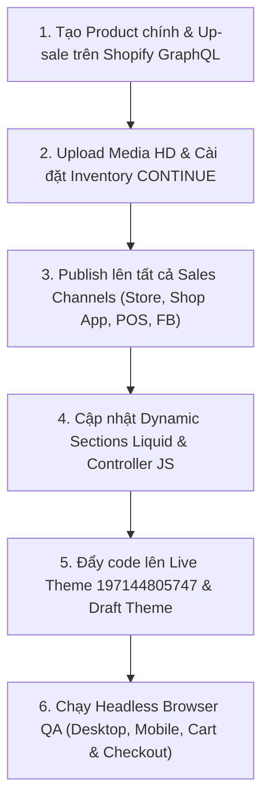

# Kế Hoạch Triển Khai: Clone Eyvelle Steam Therapy & Sản Phẩm Up-Sale LuminaLift ($29.99)

## 1. Thông Tin Sản Phẩm & Định Vị Thương Hiệu

- **Sản phẩm gốc:** [Eyvelle™ Steam Therapy](https://eyvelle.com/products/eyvelle-steam-therapy)
- **Store đích:** `ikwh1h-fx.myshopify.com` (`trymalora.com`)
- **Handle:** `eyvelle-steam-therapy` (và alias `steam-eye-therapy`)
- **Tên sản phẩm chính (Premium Medical-Aesthetic):**  
  **`Trymalora™ Nano Steam Eye Relief Therapy Wand`**
- **Định vị:** Thiết bị xông sương nano siêu âm y khoa làm ấm tuyến lệ meibomian, giải phóng tắc nghẽn màng dầu, phục hồi màng nước mắt tự nhiên, dứt điểm khô rát, mỏi mắt do màn hình máy tính chỉ sau 5 phút.

---

## 2. Sản Phẩm Up-Sale Đính Kèm (Rewrite Premium Name & $29.99)

- **Ảnh sản phẩm:** `https://ae-pic-a1.aliexpress-media.com/kf/Sa2036508456e4e449020a5de57fd474cU.jpg`
- **Handle:** `luminalift-eye-massager`
- **Tên viết lại cao cấp (Premium Rewritten Title):**  
  **`Trymalora™ LuminaLift Pro Red-Light Eye Rejuvenator & Thermal Vibration Sculptor`**
- **Nhãn hiển thị trên ô checkbox Up-sale tại PDP:**  
  **`Add LuminaLift Red-Light Eye Sculpting Wand`**
- **Giá bán up-sale:** **$29.99** *(Giá gốc niêm yết: $59.99 — Giảm 50%)*
- **Công năng tóm tắt:** "Công nghệ quang trị liệu ánh sáng đỏ 630nm kết hợp vi sóng rung 12,000 vòng/phút giúp tan bọng mắt tức thì, xoá mờ quầng thâm và nâng cơ đuôi mắt."

---

## 3. Cấu Trúc Bundle Tối Ưu Chuyển Đổi (Trymalora Luxury Bundle System)

Dựa trên hành vi mua thiết bị chăm sóc cá nhân cao cấp, chúng tôi thiết lập 3 gói bundle rõ ràng:

| Gói Bundle | Nội Dung & Quyền Lợi | Giá Bán | Giá So Sánh | Giá/Thiết Bị |
|---|---|---:|---:|---:|
| **Tier 1 — Single Starter Kit** | 1× Wand + 1× Silicone Cup + USB-C Cable + Travel Pouch | **$39.99** | $85.00 | $39.99 |
| **Tier 2 — Couple & Family Care Pack (`🔥 MOST POPULAR`)** | 2× Wands + 2× Silicone Cups + 2× Pouches *(Save Extra $10)* | **$69.98** | $170.00 | $34.99 |
| **Tier 3 — Complete Household Set (`👑 BEST VALUE`)** | 3× Wands + 3× Silicone Cups + **FREE Tracked Shipping** *(Save Extra $25)* | **$94.97** | $255.00 | $31.65 |

> Khi khách tích chọn checkbox Up-sale **Add LuminaLift Red-Light Wand**, hệ thống tự động cộng đúng **+$29.99** vào tổng đơn và nút Add to Cart cập nhật ngay lập tức ($69.98 / $99.97 / $124.96).

---

## 4. Kiến Trúc Trang Sản Phẩm (PDP Architecture)

1. **Top Badge & Rating:** `TOP RATED · EYE HEALTH & WELLNESS` · 4.9/5.0 (2,450+ verified reviews).
2. **Hero Visuals:** Bộ 7 hình ảnh HD sắc nét chuẩn từ Eyvelle (bao gồm ảnh giải phẫu tuyến lệ, so sánh trước/sau, ảnh người mẫu thực tế).
3. **5 Bullet Lợi Điểm Cốt Lõi:**
   - Sương nano siêu âm y khoa làm mềm và khai thông tuyến dầu meibomian bị tắc.
   - Nhiệt độ ấm êm dịu chuẩn nhiệt độ cơ thể, tuyệt đối không gây bỏng rát giác mạc.
   - Tương thích linh hoạt với nước cất, nước muối sinh lý hoặc dung dịch dưỡng mắt.
   - Cốc silicone y tế công thái học mềm mại, ôm khít hốc mắt chống rò rỉ 100%.
   - Liệu pháp tự nhiên 100% không dùng thuốc hoá học, an toàn cho mọi lứa tuổi.
4. **Section Package Contents:** Minh hoạ rõ 4 phụ kiện đi kèm trong hộp.
5. **Section How It Works & Science:** Đối chiếu cơ chế nhỏ thuốc mắt truyền thống (chỉ giữ ẩm vài phút) vs Liệu pháp xông sương Trymalora (giải quyết gốc rễ tuyến dầu).
6. **Section FAQ (Hỏi Đáp Y Khoa):** Trả lời 8 thắc mắc phổ biến nhất (an toàn khi đeo kính áp tròng, tần suất dùng, cách vệ sinh thiết bị, chế độ bảo hành 30 ngày).
7. **Section Customer Reviews:** Hiển thị đánh giá xác thực 5 sao với hình ảnh chân thực.

---

## 5. Quy Trình Kỹ Thuật & Các Bước Thực Hiện

---

## 6. Cam Kết & Bảo Toàn Hệ Thống

- **Zero Cross-Pollination:** Sử dụng điều kiện `` chuẩn xác, tuyệt đối không làm ảnh hưởng đến các sản phẩm hiện có (`ear-cleaner`, `metallic-silver`, `tile-refinishing`, `car-rust`).
- **Cart & Checkout đồng nhất:** Giá trên PDP, Cart Drawer và trang Checkout Shopify của cả sản phẩm chính và sản phẩm up-sale sẽ khớp chính xác từng cent.
