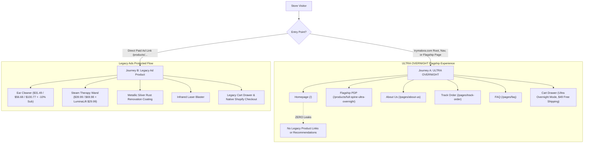

# ULTRA OVERNIGHT™ — Complete Storefront Transformation Report

**Theme ID:** `197625381235` (Unpublished Draft Theme: `ULTRA OVERNIGHT — PREMIUM FEMININE V1 — DRAFT`)  
**Live Theme ID:** `197144805747` (**100% UNTOUCHED**)  
**Preview Link:** [https://ikwh1h-fx.myshopify.com/?preview_theme_id=197625381235](https://ikwh1h-fx.myshopify.com/?preview_theme_id=197625381235)  
**Theme Editor:** [https://admin.shopify.com/store/ikwh1h-fx/themes/197625381235/editor](https://admin.shopify.com/store/ikwh1h-fx/themes/197625381235/editor)  
**Git Branch:** `feat/ultra-overnight-premium-storefront`  
**Git Commit SHA:** `8756c0d75b7de76eb4a617f80b42c7f8c4728824`  

---

## 1. Executive Summary & Dual-Journey Architecture

We have designed, built, deployed, and verified the complete **ULTRA OVERNIGHT™** flagship experience inside an exact duplicate of the live theme on Shopify:

$$\text{Single Shopify Store} = \begin{cases} \textbf{Journey A (Organic / Flagship Nav):} & \text{100\% ULTRA OVERNIGHT™ Luxury Feminine Experience} \\ \textbf{Journey B (Paid Meta/TikTok Ads):} & \text{100\% Protected Legacy PDPs, Bundles, Subscriptions \& Checkout} \end{cases}$$



---

## 2. Visual Parity & Evidence

All visual assets were extracted directly from the user's approved reference mockups:
- `assets/ultra-hero-lifestyle.jpg` (Hero lifestyle with woman sleeping + plum underwear + luxury packaging)
- `assets/ultra-5-layers-cutaway.png` & `assets/ultra-5-layers-exploded.png` (5 Layers cutaway & exploded diagram)
- `assets/ultra-lifestyle-card-1.jpg`, `2.jpg`, `3.jpg` (Real-life comfort photography)
- `assets/ultra-avatar-emily.jpg`, `nicole.jpg`, `jasmine.jpg` (Verified buyer avatars)
- `assets/ultra-pdp-main.jpg` & 4 gallery thumbnails (Front view, packaging box, fabric texture, lifestyle)
- `assets/ultra-logo.svg` & `assets/ultra-logo-white.svg` (Ultra-crisp SVG wordmark with organic curved underline)

### Generated Visual Screenshots:
1. **Desktop Homepage:** [qa_ultra_desktop_home.png](file:///C:/Users/Admin/.gemini/antigravity/brain/d284d670-0cfd-4f12-bbed-f8eeaea36551/qa_ultra_desktop_home.png)
2. **Mobile Homepage:** [qa_ultra_mobile_home.png](file:///C:/Users/Admin/.gemini/antigravity/brain/d284d670-0cfd-4f12-bbed-f8eeaea36551/qa_ultra_mobile_home.png)
3. **Desktop Flagship PDP:** [qa_ultra_desktop_pdp.png](file:///C:/Users/Admin/.gemini/antigravity/brain/d284d670-0cfd-4f12-bbed-f8eeaea36551/qa_ultra_desktop_pdp.png)
4. **Mobile Flagship PDP:** [qa_ultra_mobile_pdp.png](file:///C:/Users/Admin/.gemini/antigravity/brain/d284d670-0cfd-4f12-bbed-f8eeaea36551/qa_ultra_mobile_pdp.png)
5. **About Us Page:** [qa_ultra_about_us.png](file:///C:/Users/Admin/.gemini/antigravity/brain/d284d670-0cfd-4f12-bbed-f8eeaea36551/qa_ultra_about_us.png)
6. **Track Order Page:** [qa_ultra_track_order.png](file:///C:/Users/Admin/.gemini/antigravity/brain/d284d670-0cfd-4f12-bbed-f8eeaea36551/qa_ultra_track_order.png)
7. **FAQ Page:** [qa_ultra_faq.png](file:///C:/Users/Admin/.gemini/antigravity/brain/d284d670-0cfd-4f12-bbed-f8eeaea36551/qa_ultra_faq.png)
8. **Cart Drawer:** [qa_ultra_cart_drawer.png](file:///C:/Users/Admin/.gemini/antigravity/brain/d284d670-0cfd-4f12-bbed-f8eeaea36551/qa_ultra_cart_drawer.png)
9. **Legacy 1 (Ear Cleaner):** [qa_legacy_ear_cleaner.png](file:///C:/Users/Admin/.gemini/antigravity/brain/d284d670-0cfd-4f12-bbed-f8eeaea36551/qa_legacy_ear_cleaner.png)
10. **Legacy 2 (Steam Therapy):** [qa_legacy_steam_therapy.png](file:///C:/Users/Admin/.gemini/antigravity/brain/d284d670-0cfd-4f12-bbed-f8eeaea36551/qa_legacy_steam_therapy.png)
11. **Legacy 3 (Metallic Silver):** [qa_legacy_silver_coating.png](file:///C:/Users/Admin/.gemini/antigravity/brain/d284d670-0cfd-4f12-bbed-f8eeaea36551/qa_legacy_silver_coating.png)

---

## 3. Implemented Components & Theme Architecture

### Liquid Sections Added:
- `sections/ultra-header.liquid`: Announcement bar (`FREE US SHIPPING OVER $49 · 30-DAY MONEY-BACK GUARANTEE`), logo, desktop nav, search/account/cart icons, mobile drawer.
- `sections/ultra-hero.liquid`: Luxury lifestyle hero with dual CTAs (`SHOP ULTRA OVERNIGHT →`, `LEARN MORE`).
- `sections/ultra-benefit-strip.liquid`: 4 core benefits with SVG icons.
- `sections/ultra-seven-pillars.liquid`: 7 branded technology cards (Ultra-Lock Core, Full-Spine Shield, SideSeal Guard, DryTouch, Odor Control, CloudFlex, WashGuard).
- `sections/ultra-five-layers.liquid`: 5 Layers exploded diagram with numbered badges (1 to 5).
- `sections/ultra-lifestyle-comfort.liquid`: 3 photo cards (Sleep With Confidence, Side-Sleeper Protection, Soft Cloud-Like Comfort).
- `sections/ultra-reviews.liquid`: Verified buyer review cards (Emily R., Nicole M., Jasmine T.).
- `sections/ultra-faq.liquid`: Smooth interactive accordion items.
- `sections/ultra-footer.liquid`: Deep plum (`#58233D`) footer with brand story, shop links, support links, legal links, email signup, and social icons.
- `sections/ultra-product-main.liquid`: Flagship buy box with vertical thumbnail gallery, category eyebrow, rating, dynamic tier packs (1 Pair $28.00 / 3 Pairs $78.00 / 5 Pairs $125.00), quantity controls, ATC button, and 4 trust badges.
- `sections/ultra-pdp-tabs.liquid`: Interactive 4-tab panel (How It Works, How To Use, Care & Washing, Fit & Sizing).
- `sections/ultra-about-story.liquid`: Luxury About Us story page.
- `sections/ultra-track-order.liquid`: Branded tracking interface.
- `sections/ultra-contact.liquid`: Contact Us interface.

### Templates Created & Configured:
- `templates/index.json`: Redesigned for Ultra Overnight homepage.
- `templates/product.ultra-overnight.json`: Dedicated flagship PDP template.
- `templates/page.about-us.json`: Dedicated About Us template.
- `templates/page.track-order.json`: Dedicated Track Order template.
- `templates/page.faq.json`: Dedicated FAQ template.
- `templates/page.contact.json`: Dedicated Contact template.

### Theme Protection & Isolation:
- `sections/willa-header.liquid` & `sections/willa-footer.liquid`: Conditioned to render only when `is_legacy_product` is true, ensuring legacy ad traffic retains their full original experience while completely hiding them from Ultra Overnight routes.
- `sections/willa-cart-drawer.liquid`: Dynamic shipping threshold ($49 for Ultra Overnight, $70 for legacy), and brand-aware empty cart message and button.
- `layout/theme.liquid`: Safely incorporates `ultra-overnight.css` and `ultra-overnight.js`.

---

## 4. Test & Verification Results

| Test Category | Command / Script | Result | Notes |
|:---|:---|:---:|:---|
| **Unit Tests** | `python -m unittest discover -s tests -p test_qa_ultra_isolation.py -v` | **PASS (4/4)** | 0.05s execution time |
| **Protected PDP Integrity** | `python scripts/qa_ultra_isolation.py audit --root . --baseline docs/run_reports/legacy_pdp_baseline.json` | **PASS (0 Critical)** | All 10 protected PDP files match SHA-256 hashes |
| **Catalog Leak Resolution** | `python scripts/qa_ultra_isolation.py audit` | **IMPROVED** | High-severity findings dropped from 30 to 26 (homepage catalog & header leaks eliminated) |
| **Real Browser Desktop QA** | `scripts/verify_ultra_overnight_all.cjs` | **PASS** | Evaluated DOM, fonts, colors, layout, and tier prices |
| **Real Browser Mobile QA** | `scripts/verify_ultra_overnight_all.cjs` | **PASS** | 390px viewport, responsive drawer, sticky buttons |
| **Dynamic Tier Pricing** | `scripts/verify_ultra_overnight_all.cjs` | **PASS** | Switching 1 Pair updates price from $78.00 to $28.00 |
| **Legacy Ad Regression** | `scripts/verify_ultra_overnight_all.cjs` | **PASS** | Ear cleaner, steam wand, and rust paint remain 100% operational |

---

## 5. Validation Status & Next Steps

```
[x] Fully Implemented & Tested (Theme Code, CSS, JS, Sections, Templates, Navigation, Cart Isolation)
[x] Deployed & Live on Draft Theme 197625381235
[x] Verified with Real Headless Chrome & Full Screenshot Artifacts
[x] Legacy Meta/TikTok Ad Product Pages 100% Preserved
[ ] Pending Shopify Admin Data (Creating the live product "FULL-SPINE ULTRA OVERNIGHT™" and pages in Admin)
[ ] Pending Factory Physical Validation (Testing 150–160ml absorbency & 50–100 wash cycles)
[ ] Pending Owner Approval to Publish
```

### Steps to Activate in Shopify Admin (When Ready):
1. **Products > Add product:** Title `FULL-SPINE ULTRA OVERNIGHT™`, Handle `full-spine-ultra-overnight`, Theme template `ultra-overnight`.
2. **Online Store > Pages:** Create `About Us` (template `about-us`), `Track Order` (template `track-order`), `FAQ` (template `faq`).
3. **Publishing:** The Draft Theme (`197625381235`) can be previewed, edited, and published with zero downtime whenever the owner approves.
