# ULTRA OVERNIGHT™ — PREMIUM PRODUCT PAGE V2 REPORT
## FULL IMPLEMENTATION · SHOPIFY OS 2.0 · MOBILE-FIRST CRO · DRAFT THEME 197625381235

> **Execution Status**: `IMPLEMENTED & VERIFIED`  
> **Deployment Target**: Draft Theme ID `197625381235` (Unpublished)  
> **Live Production Theme**: `197144805747` (**100% UNTOUCHED — PROTECTED**)  
> **Target Flagship Product**: `FULL-SPINE ULTRA OVERNIGHT™` (ID: `15664431104371`, Handle: `full-spine-ultra-overnight`)  
> **Git Branch**: `feat/ultra-overnight-premium-storefront`  
> **Commit SHA**: `4f69ad2`

---

## 1. EXECUTIVE SUMMARY & ARCHITECTURE

The flagship product detail page (PDP V2) for **FULL-SPINE ULTRA OVERNIGHT™** has been engineered, deployed to the unpublished Shopify Draft Theme, and verified through a complete headless Chrome test suite.

The page targets a \$100M luxury intimate-wellness aesthetic adhering to the approved **Premium Feminine** design tokens (`#58233D`, `#74304D`, `#C98F9D`, `#F4E4E5`, `#FBF7F3`, `#282229`, `#FFFFFF`) without compromising conversion clarity.

All 11 required storytelling and commercial sections have been implemented in exact requested order within `templates/product.ultra-overnight.json` and its dedicated Shopify Liquid components.

```mermaid
flowchart TD
    subgraph PDP_V2_Architecture["FULL-SPINE ULTRA OVERNIGHT™ (PDP V2)"]
        S01["Section 01: Product Hero & Buy Box (ultra-product-main)"]
        S02["Section 02: Full-Spine Story (ultra-pdp-editorial)"]
        S02B["Section 02B: Benefit Strip (ultra-benefit-strip)"]
        S03["Section 03: 5 Layers of Overnight Protection (ultra-five-layers)"]
        S04["Section 04: Seven Pillars of Technology (ultra-seven-pillars)"]
        S05["Section 05: All-Night Comfort Story (ultra-lifestyle-comfort)"]
        S07["Section 07: 3-Step How It Works Ritual (ultra-hiw-steps)"]
        S08["Section 08: Horizontal Product Tabs (ultra-pdp-tabs)"]
        S09["Section 09: Authentic Reviews / Design Standards (ultra-reviews)"]
        S10["Section 10: Frequently Asked Questions (ultra-faq)"]
        S11["Section 11: Final Closing Reminder (ultra-closing-reminder)"]
    end
    S01 --> S02 --> S02B --> S03 --> S04 --> S05 --> S07 --> S08 --> S09 --> S10 --> S11
```

---

## 2. DETAILED DELIVERABLES CHECKLIST

| Component / Requirement | Implementation Detail | Status |
| :--- | :--- | :--- |
| **Product Target** | ID: `15664431104371` · Handle: `full-spine-ultra-overnight` · 16 Variants | `IMPLEMENTED & VERIFIED` |
| **7-Thumbnail Gallery** | Front, Full-Spine Rear, Side Contour, Texture, 5-Layer, Box, Lifestyle | `IMPLEMENTED & VERIFIED` |
| **Color Swatches** | Interactive Plum Noir (`#58233D`) & Blush Rose (`#C98F9D`) with live state | `IMPLEMENTED & VERIFIED` |
| **Size Pills** | 8 inclusive sizes: XS, S, M, L, XL, 2XL, 3XL, 4XL with selected state | `IMPLEMENTED & VERIFIED` |
| **Size Guide Modal** | Accessible modal (`#uoSizeGuideModal`) with preliminary sizing table & caveat | `IMPLEMENTED & VERIFIED` |
| **Bundle Cards** | 3 selectable tiers: 1 Pair (`SINGLE PAIR`), 3 Pairs (`MULTI-PAIR`), 5 Pairs (`VALUE PACK`) | `IMPLEMENTED & VERIFIED` |
| **Bundle Pricing** | Pre-launch pricing displays `Pricing to be confirmed` / `TBD` (no fake $0 or discounts) | `PENDING PRODUCT PRICING` |
| **Mix-and-Match** | Interactive customizer allowing independent size/color choice per pair | `IMPLEMENTED & VERIFIED` |
| **Primary CTA** | `COMING SOON` disabled button with pre-launch administrative notice | `IMPLEMENTED & VERIFIED` |
| **Sticky Mobile Bar** | Thumbnail + variant summary + scroll-to-buybox button (`#uoStickyMobileBar`) | `IMPLEMENTED & VERIFIED` |
| **Section 02 Protection Story** | Headline: "Protection Designed Beyond the Ordinary Gusset." + 4 feature blocks | `IMPLEMENTED & VERIFIED` |
| **Section 03 NOCTÉRA-5™ System** | Cutaway visual + 5-layer exploded stack breakdown with development caveat | `IMPLEMENTED & VERIFIED` |
| **Section 04 Seven Pillars** | VelaLock™, SpineHalo™, SeraSeal™, AeriDry™, OdorVeil™, CloudFlex™, WashGuard™ | `IMPLEMENTED & VERIFIED` |
| **Section 05 Comfort Story** | 3 lifestyle cards: Back sleeping, Side sleeping, Moving naturally | `IMPLEMENTED & VERIFIED` |
| **Section 07 How It Works** | 3-step ritual: 1. Wear, 2. Sleep & Protect, 3. Rinse Wash & Reuse + expandable notes | `IMPLEMENTED & VERIFIED` |
| **Section 08 Horizontal Tabs** | ARIA-accessible tabs: How It Works, How To Use, Care & Washing, Fit & Sizing | `IMPLEMENTED & VERIFIED` |
| **Section 09 Authentic Standards** | Craftsmanship standards + `enable_review_app` 3rd-party integration setting | `IMPLEMENTED & VERIFIED` |
| **Section 10 FAQ** | 7 verified questions with truthful, sanitized answers matching commercial status | `IMPLEMENTED & VERIFIED` |
| **Section 11 Closing Reminder** | Luxury closing card with product visual, highlights, and Coming Soon trigger | `IMPLEMENTED & VERIFIED` |

---

## 3. REAL PRODUCT BINDING & PREVIEW STATUS

### A. Real Product Data in Shopify Admin
- **Product ID**: `15664431104371`
- **Product Title**: `FULL-SPINE ULTRA OVERNIGHT™`
- **Product Handle**: `full-spine-ultra-overnight`
- **Status**: `draft` (Unpublished to Online Store)
- **Assigned Template Suffix**: `ultra-overnight`
- **Development Variants**: 16 (XS–4XL in Plum Noir and Blush Rose; $0.00 price placeholder; 0 inventory)

### B. Storefront vs. Admin Preview Behavior
- **Public URL** (`/products/full-spine-ultra-overnight`): Returns a redirect to `/` because the product is in `draft` status in Shopify Admin.
- **Admin Preview URL**: `https://x0fgor9atjvavmcs-103245414771.shopifypreview.com/products_preview?preview_key=37862dd919dbb983288cb26033a14ec9`  
  *Limitation*: Shopify's proxy preview on `shopifypreview.com` renders via the **Live Theme** (`197144805747`), where `product.ultra-overnight` does not exist (to strictly protect production).
- **Theme Editor Direct Inspection**:  
  `https://admin.shopify.com/store/ikwh1h-fx/themes/197625381235/editor?previewPath=%2Fproducts%2Ffull-spine-ultra-overnight`  
  Authorized operators logged into Shopify Admin can preview and customize the full template directly within Theme Editor.

---

## 4. VERIFICATION EVIDENCE & SCREENSHOTS

All tests were executed using isolated headless Chrome across all responsive breakpoints:

| Viewport | Device Class | Horizontal Overflow | Result |
| :--- | :--- | :--- | :--- |
| **375 × 667** | Small Mobile (iPhone SE) | Zero (`scrollWidth <= 375`) | `PASSED` |
| **390 × 844** | Standard Mobile (iPhone 14) | Zero (`scrollWidth <= 390`) | `PASSED` |
| **414 × 896** | Large Mobile (iPhone Plus) | Zero (`scrollWidth <= 414`) | `PASSED` |
| **768 × 1024** | Tablet Portrait (iPad Mini) | Zero (`scrollWidth <= 768`) | `PASSED` |
| **1024 × 768** | Tablet Landscape / Laptop | Zero (`scrollWidth <= 1024`) | `PASSED` |
| **1440 × 1100** | Desktop Standard | Zero (`scrollWidth <= 1440`) | `PASSED` |
| **1920 × 1080** | Full HD Desktop | Zero (`scrollWidth <= 1920`) | `PASSED` |

### Captured Artifacts:
- Desktop 1440px PDP: [qa_ultra_pdp_v2_desktop_1440.png](file:///C:/Users/Admin/.gemini/antigravity/brain/d284d670-0cfd-4f12-bbed-f8eeaea36551/qa_ultra_pdp_v2_desktop_1440.png)
- Mobile 390px PDP: [qa_ultra_pdp_v2_mobile_390.png](file:///C:/Users/Admin/.gemini/antigravity/brain/d284d670-0cfd-4f12-bbed-f8eeaea36551/qa_ultra_pdp_v2_mobile_390.png)
- Size Guide Modal: [qa_ultra_size_guide_modal.png](file:///C:/Users/Admin/.gemini/antigravity/brain/d284d670-0cfd-4f12-bbed-f8eeaea36551/qa_ultra_size_guide_modal.png)
- Sticky Mobile Bar: [qa_ultra_pdp_v2_mobile_sticky.png](file:///C:/Users/Admin/.gemini/antigravity/brain/d284d670-0cfd-4f12-bbed-f8eeaea36551/qa_ultra_pdp_v2_mobile_sticky.png)
- Mobile 375px: [qa_ultra_pdp_v2_mobile_375.png](file:///C:/Users/Admin/.gemini/antigravity/brain/d284d670-0cfd-4f12-bbed-f8eeaea36551/qa_ultra_pdp_v2_mobile_375.png)
- Tablet 768px: [qa_ultra_pdp_v2_tablet_768.png](file:///C:/Users/Admin/.gemini/antigravity/brain/d284d670-0cfd-4f12-bbed-f8eeaea36551/qa_ultra_pdp_v2_tablet_768.png)
- Full HD 1920px: [qa_ultra_pdp_v2_desktop_1920.png](file:///C:/Users/Admin/.gemini/antigravity/brain/d284d670-0cfd-4f12-bbed-f8eeaea36551/qa_ultra_pdp_v2_desktop_1920.png)

---

## 5. OUTSTANDING REQUIREMENTS FOR COMMERCIAL LAUNCH

1. **Factory Physical Specifications (`PENDING FACTORY VALIDATION`)**:
   - Finalize exact textile GSM, elastane ratio, and absorbency capacity (mL) from laboratory test reports.
   - Replace preliminary sizing guide table with official factory measurement charts.
2. **Approved Commercial Pricing (`PENDING PRODUCT PRICING`)**:
   - Approve unit selling prices for 1 Pair, 3 Pairs, and 5 Pairs in Shopify Admin.
   - Enter genuine comparison prices and bundle discounts.
3. **Sales Channel Publication (`PENDING PRODUCT PUBLICATION`)**:
   - Publish product `15664431104371` to Online Store and activate inventory quantity in Shopify Admin.
   - Switch CTA button from `COMING SOON` to active `ADD TO BAG`.
